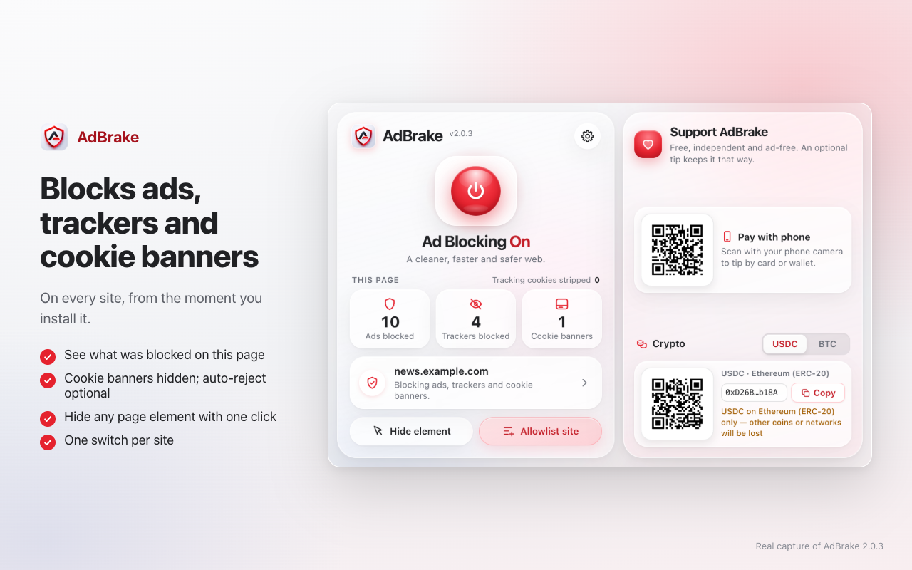
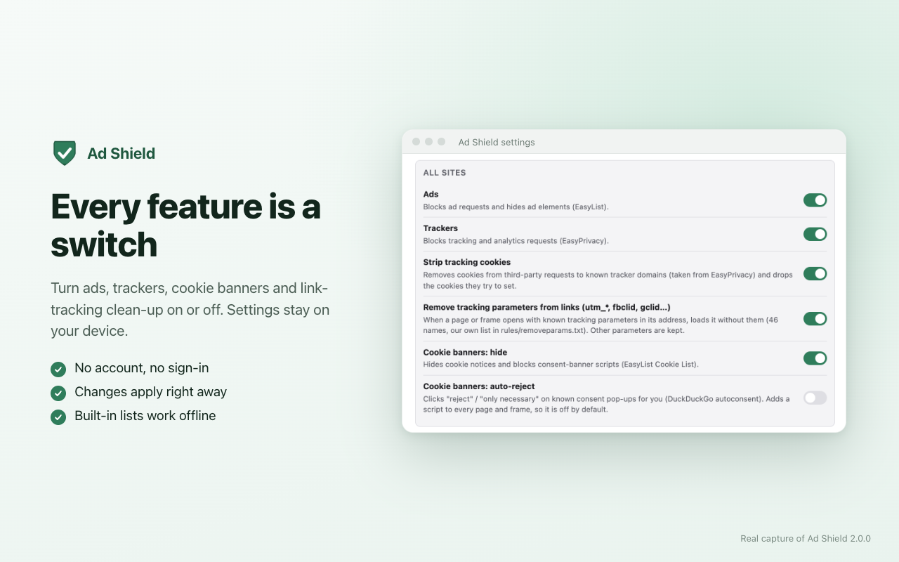
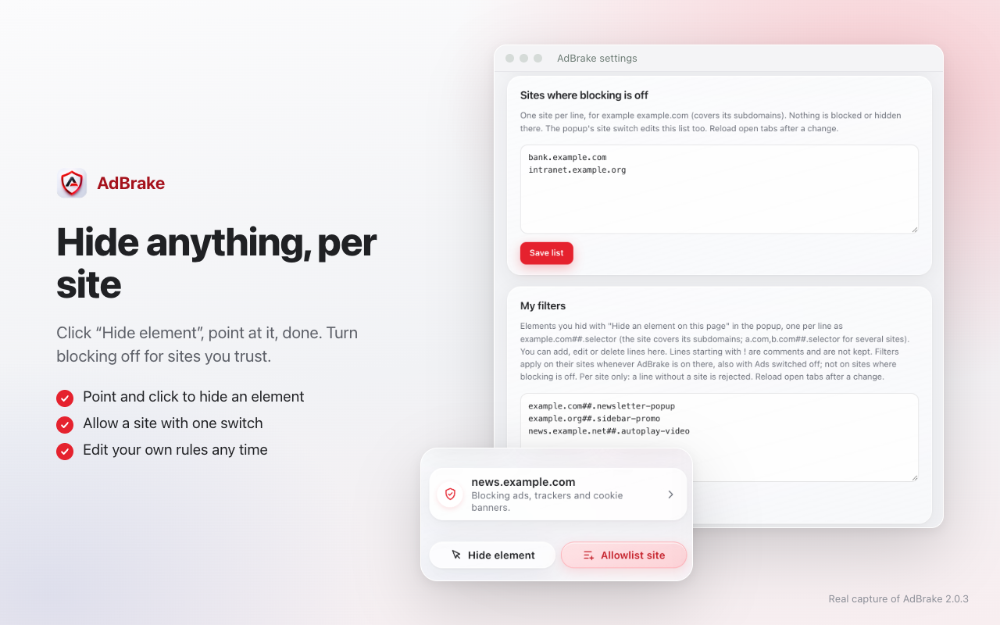
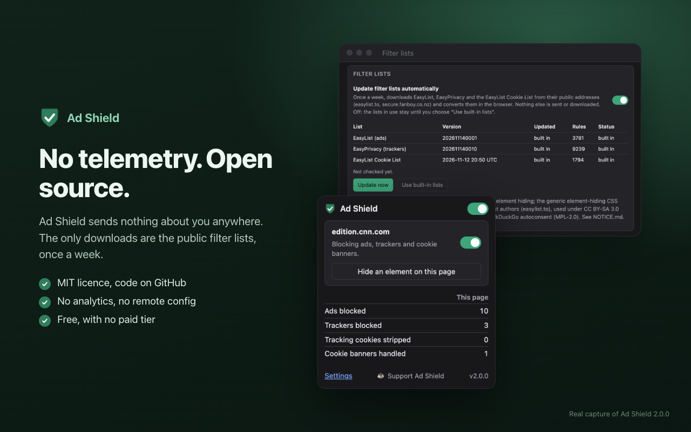
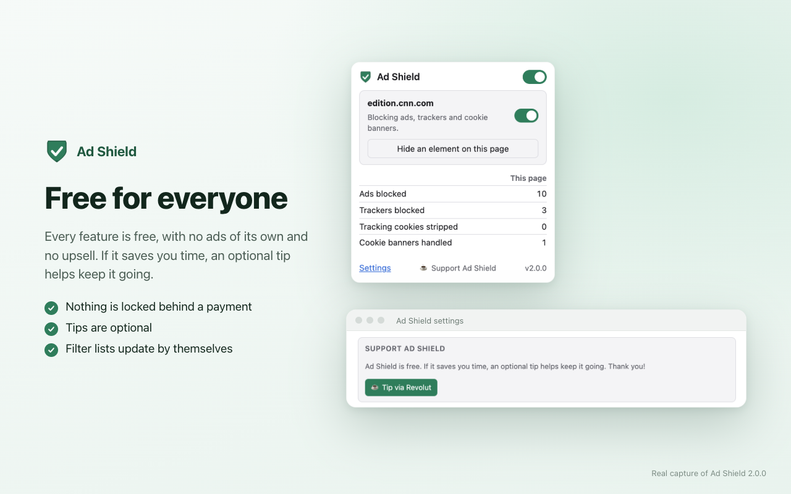

<p align="center"></p>

<h1 align="center">AdBrake</h1>

<p align="center"><strong>A free, open-source ad, tracker and cookie-banner blocker for Chrome, Edge, Opera and Brave.</strong><br>
No telemetry. No accounts. No remote configuration.</p>

<p align="center">
  
  
  
  
</p>

<p align="center">
  <a href="#install">Install</a> ·
  <a href="#what-it-does">Features</a> ·
  <a href="#privacy">Privacy</a> ·
  <a href="#support">Support</a> ·
  <a href="https://marsselal.github.io/ad-shield/store/privacy-policy.html">Privacy policy</a>
</p>



### Highlights

- **Blocks ads and trackers on every site** with Chrome's built-in rule engine (filter rules from
  EasyList and EasyPrivacy), before they load.
- **Hides cookie banners**; optional auto-reject (off by default).
- **Strips tracking cookies and tracking parameters** (`utm_*`, `fbclid`, `gclid` and others).
- **Works on video sites too**, including YouTube and Twitch. These sites change often, so this
  part can stop working until an update, and some ads cannot be removed.
- **Hide any element** with a point-and-click picker; your own rules are editable in Settings.
- **One switch per site** for pages that break.
- **Private by design**: settings stay in your browser; the only downloads are the three public
  filter lists, once a week ([privacy policy](https://marsselal.github.io/ad-shield/store/privacy-policy.html)).

AdBrake is not a perfect blocker: Chrome's rule system cannot express everything that
uBlock Origin can, so some ads get through. Do not run two ad blockers at once.

<table>
  <tr>
    <td></td>
    <td></td>
  </tr>
  <tr>
    <td></td>
    <td></td>
  </tr>
</table>

---

A Manifest V3 browser extension (Chrome 120+, also Edge, Opera and Brave) that blocks ads,
trackers, tracking cookies and cookie banners on all sites, and video ads on Twitch live
streams. Plain JavaScript, no runtime dependencies, no proxies, no telemetry, no remote
configuration.

## What it does

**On all sites** (built from EasyList, EasyPrivacy and the EasyList Cookie List):

- **Ads**: blocks ad requests (static declarativeNetRequest rules) and hides ad elements
  (element-hiding CSS).
- **Trackers**: blocks tracking and analytics requests.
- **Tracking cookies**: removes the `Cookie` request header and the `Set-Cookie` response header
  on third-party requests to about 3,800 known tracker domains (taken from EasyPrivacy).
- **Cookie banners: hide**: blocks consent-banner scripts and hides cookie notices.
- **Cookie banners: auto-reject** (off by default): DuckDuckGo's autoconsent clicks "reject" /
  "only necessary" on known consent pop-ups.
- **YouTube ads and anti-adblock walls** (on with Ads; option "Fix YouTube ads and anti-adblock
  walls (page scripts)"): our own small page scripts ("scriptlets", `rules/scriptlets.json`)
  remove the ad entries (`adPlacements`, `playerAds`, `adSlots`, feed and Shorts ad items) from
  YouTube's player and feed data before the page uses it, keep that pruning in place when the
  page takes a fresh `fetch` from a new frame, drop the player's anti-adblock report
  (`onAbnormalityDetected`) before it reaches the page, and, if an ad still plays, mute it and
  jump to its end (Skip is not clicked: YouTube treats a script's click as tampering). Plus YouTube-only
  hiding CSS and two network rules (`/pagead/`, `/youtubei/v1/player/ad_break`). They run on
  youtube.com, youtube-nocookie.com and youtubekids.com only.
- **Per-site switch**: the popup turns everything off for the current site (allowlist).
- **Tracking parameters** (option "Remove tracking parameters from links (utm_*, fbclid,
  gclid…)", on by default): when a page or frame opens with one of 46 known tracking parameters
  in its address (UTM tags, ad click ids such as `fbclid`, `gclid`, `msclkid`, e-mail tracking
  such as `mc_eid`, `_hsenc`), Chrome loads it without them; other parameters are kept. Our own
  list (`rules/removeparams.txt`, MIT), one static redirect ruleset (`removeparam`). Generic
  names (`ref`, `si`, `source`, ...) and Marketo's `mkt_tok` (unsubscribe links) are left alone.
- **Hide an element** (popup): an element picker. Point at an element, click it, adjust with
  "Wider" / "Narrower" (live preview with the number of matches) and press "Hide". The rule is
  kept under **My filters** on the options page (`example.com##.selector`, editable there) and
  applied on every visit to that site. Per site only; top frame only.
- **Weekly filter-list updates** (on by default, can be switched off): downloads the three lists
  from their public addresses once a week, converts them in the browser and installs them as
  dynamic rules; "Update now" and "Use built-in lists" on the options page. The generic
  element-hiding CSS stays as built into the extension.

**On Twitch** (unchanged): when a stream playlist contains an ad, the extension asks Twitch for
the same stream with a different player type (a "backup stream") and plays that copy if it has
no ad. If every backup also has the ad, it removes the ad segments from the playlist. It also
blocks Twitch's client-side ad requests and hides standalone ad videos.

Test status: see [docs/TESTING.md](docs/TESTING.md). Short version: offline tests and a
browser smoke test pass (the smoke test checks the general rules with Chrome's own matcher and
the cosmetic CSS on a local page); a live Twitch run showed normal playback, but no ad appeared
in the automated run, so Twitch ad blocking was not yet proven there.

## Install

**From a browser store** (store listings are being submitted; links will be added here when they are live):

- Chrome Web Store: _link to be added_
- Microsoft Edge Add-ons: _link to be added_
- Opera add-ons: _link to be added_

**From source (unpacked)**, for development or before the store listings are live:

1. Get the code: `git clone https://github.com/MarsselAL/ad-shield.git` (or download the zip from GitHub).
2. Open `chrome://extensions` (Edge: `edge://extensions`, Brave: `brave://extensions`).
3. Turn on **Developer mode** (top right).
4. Click **Load unpacked** and choose the folder that contains `manifest.json`.
5. Reload tabs that were already open.

The built files in `build/` are committed. To rebuild them: `python3 tools/build.py`.

## Share a build / install on another computer (no store)

1. Run `python3 -I tools/package.py`. It makes `dist/adbrake-<version>.zip` with one folder
   `adbrake/` inside: the extension plus **`INSTALL.txt`** (source: [docs/INSTALL.txt](docs/INSTALL.txt)).
   Tests, tools, docs and test results are left out. It also makes
   `dist/adbrake-<version>-store.zip` (`manifest.json` at the zip root, no `INSTALL.txt`) for
   uploading to the browser stores.
2. Send the zip (USB stick, cloud drive, e-mail).
3. The other person follows `INSTALL.txt`: unzip to a permanent folder, open
   `chrome://extensions`, turn on **Developer mode**, **Load unpacked**, pick the `adbrake`
   folder. It also covers macOS, the "developer mode extensions" message at browser start
   (expected; close it, do not disable), pinning the icon, the settings, weekly list updates,
   updating to a new zip and uninstalling.

## Contributing and security

Bug reports and pull requests are welcome: see [CONTRIBUTING.md](CONTRIBUTING.md). Report
security problems privately as described in [SECURITY.md](SECURITY.md). Store submission notes
for maintainers are in [docs/store/](docs/store/) (release steps: [docs/store/release.md](docs/store/release.md)).

## How it works

General blocking (details in [docs/ARCHITECTURE.md](docs/ARCHITECTURE.md)):

- `tools/build_rules.py` downloads the three lists with `curl` into a fresh temporary folder and
  converts them with our own converter (`tools/filterlist.py`) into static DNR rulesets in
  `rules/` (`ads_1`, `privacy_1`, `cookies_1`, `cookie_strip`) and cosmetic data in
  `rules/cosmetic/`. It also turns our own hand-written host list `rules/curated_hosts.txt` into
  `ads_curated` and `privacy_curated` (`--curated-only` rebuilds just those, offline). The output is committed, so the extension works offline.
- Weekly updates: the background downloads the same three lists, converts them with a
  JavaScript port of the converter (`src/shared/filterlist.js`, checked against the Python output
  by a golden-file test) and installs them as dynamic rules in place of `ads_N` / `privacy_N` /
  `cookies_N` (all three or none; sanity checks on versions and rule counts). The site-specific
  hiding data is replaced too; the generic hiding CSS is not.
- Generic element hiding is a CSS file registered as a content script: no JavaScript runs for it.
  Site-specific hiding: a tiny page script (top frame only) says hello, and the background
  injects that site's CSS with `chrome.scripting.insertCSS`. No MutationObserver, no polling.
- Auto-reject: the unmodified autoconsent content script (`vendor/autoconsent/`) runs in all
  frames while the option is on; the background answers its messages (rules, page-world
  snippets) as its documentation describes.
- Allowlisted sites get one dynamic `allowAllRequests` rule and are excluded from all content
  scripts.
- Scriptlets: `src/scriptlets/lib.js` (our own code, no GPL code) + the rules in
  `rules/scriptlets.json` are built into `build/scriptlets-main.js`, registered in the page's
  MAIN world at `document_start` (all frames) for the hosts named in the rules only. Shipped in
  the package; nothing is downloaded.

Twitch:

- A script in the page (MAIN world) wraps `fetch` and Twitch's video Web Worker.
- Inside the worker, each media playlist is checked for ad markers. If one is found, the
  worker fetches the same stream as other player types, and serves the first one without ads.
  If none is clean, it strips the ad segments.
- If anything goes wrong, the original response is passed through unchanged.
- A small bridge script (ISOLATED world) passes settings and events; the background service
  worker keeps settings, statistics and the network block lists.
- The Twitch content scripts are declared in `manifest.json` (`build/main-world.js`,
  `build/isolated-world.js`). They are not loaded on `clips.twitch.tv`.

## Converted filters (lists of 2026-11-13)

| Ruleset | Rules | Of which allow | Source |
|---|---|---|---|
| `ads_1` | 3,781 | 516 | EasyList |
| `ads_curated` | 1 (44 hosts) | 0 | `rules/curated_hosts.txt` (ours) |
| `privacy_1` | 9,239 | 842 | EasyPrivacy |
| `privacy_curated` | 1 (45 hosts) | 0 | `rules/curated_hosts.txt` (ours) |
| `cookies_1` | 1,794 | 427 | EasyList Cookie List |
| `cookie_strip` | 4 (3,791 domains) | 0 | EasyPrivacy `\|\|domain^$third-party` |
| `youtube` | 4 | 0 | `rules/youtube.json` (ours, hand-written) |
| `removeparam` | 92 (46 names) | 0 | `rules/removeparams.txt` (ours) |
| `client_ads`, `trackers` | 2 + 2 | 0 | Twitch rules (ours; `client_ads` = 2 allow rules) |

Total 14,920 static rules, below Chrome's guaranteed 30,000, so no shared global pool is needed.
Plain `||domain^` filters with the same options are merged into one rule with `requestDomains`
(1,000 domains per rule), which is why the counts are small. Cosmetic: 13,635 generic and 16,492
site-specific EasyList selectors, 15,272 generic and 18,736 site-specific cookie-list selectors.

Skipped (counted in `rules/build-info.json`): EasyList 4,156 of 77,788 filters (mostly 2,969
`$popup` and 572 `$document` page blocks DNR cannot express, 295 procedural/scriptlet, 240
wildcard-TLD domains); EasyPrivacy 75 of 56,631 (mostly `$redirect`); cookie list 79 of
25,382. Not converted at all: procedural cosmetic filters (`#?#`, `:has-text()`), scriptlets
(`##+js`, `#$#`), `$redirect`, `$csp`, `$removeparam` (our own parameter list is used instead),
`$rewrite`, `$popup`, complex regex.

To rebuild with fresh lists: `python3 -I tools/build_rules.py`, then `bash tests/run.sh`.

## Permissions and why

| Permission | Why |
|---|---|
| `storage` | Settings, allowlist and statistics. |
| `scripting` | Registers the cosmetic CSS / page script / autoconsent content scripts; injects site CSS and My filters; injects the element picker when you click "Hide an element on this page"; runs autoconsent's page-world snippets; removes leftover dynamic scripts of older versions. |
| `declarativeNetRequest` | Static rulesets in `rules/` and the dynamic allowlist rule. |
| `declarativeNetRequestFeedback` | Popup counts via `getMatchedRules` and the badge count (see below). |
| host `<all_urls>` | Needed for `modifyHeaders` (cookie stripping), for CSS on all sites and for autoconsent. |

There is no `tabs`, `webRequest`, `webNavigation`, `cookies` or `proxy` permission.

### Why `getMatchedRules` for the counts

The extension is installed unpacked, so both feedback APIs would work. `onRuleMatchedDebug`
fires for every matched request and keeps the service worker awake (and is unpacked-only),
which costs performance on every page. Instead the popup calls
`chrome.declarativeNetRequest.getMatchedRules({tabId, minTimeStamp})` once when it opens
(rate limit: 20 calls per 10 minutes) and sorts the matches by ruleset into ads, trackers,
cookies stripped and cookie-banner scripts blocked; allow rules are left out by their id range.
"Cookie banners handled" also adds banners the page script saw hidden and pop-ups autoconsent
rejected. The toolbar badge uses
`setExtensionActionOptions({displayActionCountAsBadgeText: true})` (Chrome counts blocked
requests itself); on Twitch tabs the Twitch count replaces it once a video ad was handled.

## Privacy

- No telemetry, no analytics, no accounts, no remote configuration, no proxies.
- The only network requests the extension itself makes:
  - the weekly downloads of the three public filter lists
    (`https://easylist.to/easylist/easylist.txt`, `https://easylist.to/easylist/easyprivacy.txt`,
    `https://secure.fanboy.co.nz/fanboy-cookiemonster.txt`) while "Update filter lists
    automatically" is on, or when you press "Update now". No cookies or other data are sent with
    them. Switch the option off to stop them;
  - on Twitch pages only, when a stream has an ad: requests to Twitch's own servers
    (`gql.twitch.tv` for a playback token, `usher.ttvnw.net` for the playlist) for the same stream
    as another player type ("backup stream"), sent from the Twitch page like the player's own.
- The element picker, "My filters" and the tracking-parameter removal are fully local (no
  requests; tracking parameters are removed by a browser rule before the page loads).
- autoconsent is downloaded only when you run `tools/vendor_autoconsent.py`, never by the
  extension.
- Settings, the allowlist, "My filters" and statistics stay in your browser (`chrome.storage`).

## Settings and on/off switch

The popup has the master switch, the per-site switch, counts for the current page and, on
Twitch tabs, the Twitch status and counts. The options page has these settings:

| Setting | Default | Effect |
|---|---|---|
| Enabled | on | Master switch for everything (all-sites features and Twitch). |
| Debug logging | off | `[TAS]` debug lines in the page and extension consoles (warnings/errors always). |
| Ads | on | Rulesets `ads_*` and `youtube` + EasyList element hiding + YouTube hiding CSS. |
| Fix YouTube ads and anti-adblock walls (page scripts) | on | MAIN-world scriptlets on YouTube hosts (`build/scriptlets-main.js`); only while Ads is on. |
| Trackers | on | Rulesets `privacy_*`. |
| Strip tracking cookies | on | Ruleset `cookie_strip`. Requests that another rule blocks are blocked anyway; an exception (allow) rule also stops the stripping. |
| Remove tracking parameters from links | on | Ruleset `removeparam`: pages and frames whose address has one of the 46 names in `rules/removeparams.txt` are loaded without them (one redirect). Priority 50: above the list rules, below the per-site allowlist. Not counted in the popup. |
| Cookie banners: hide | on | Rulesets `cookies_*` + cookie-list element hiding. |
| Cookie banners: auto-reject | off | Registers autoconsent (a ~160 KB script in every page and frame). |
| Update filter lists automatically | on | Weekly download and conversion of the three lists (dynamic rules; the generic hiding CSS stays from the package). The options page shows each list's version, date, rule count and status, with "Update now" and "Use built-in lists". |
| Sites where blocking is off | empty | One site per line, covers subdomains. Also turns the Twitch features off on twitch.tv. |
| My filters | empty | `site##selector` per line (from the element picker or typed). Applied on that site (and its subdomains) whenever AdBrake is on there, even with Ads off. Caps: 200 per site, 5,000 in all. |
| Block client-side ad requests on videos (VODs) | on | On `twitch.tv/videos/…` (and the embedded player with `?video=`) only, the page and its video worker answer Twitch's client-side ad requests (`edge.ads.twitch.tv`, `vaes.amazon-adsystem.com` ad paths, GET) locally with "no ad". Live streams are never touched: a failed ad request there is the likely trigger of Twitch's "you're running ad block" notice, so the always-on ruleset `client_ads` holds two allow rules (priority 5) that let these requests from twitch.tv pages through although EasyList blocks `edge.ads.twitch.tv`. Up to 2.0 `client_ads` blocked them on every page. |
| Block ad tracking paths | off | DNR ruleset `trackers`: `twitch.tv/r/s/` (scripts) and `/r/c/` (images). Untested on live Twitch. |
| Hide standalone video ads | on | Hides, mutes and pauses ad `<video>` elements whose source is an Amazon ad host, and hides the display ads beside / below the player (`[data-test-selector="display-ad"]`, `[data-test-selector="ad-banner"]`, `[data-a-target="ads-banner"]`, `iframe[title="Stream Display Ad"]`, `.stream-display-ad`), muting and pausing any `<video>` in them; never a container that holds the stream's player. |
| Prefer AVC (H.264) streams | on | Removes HEVC/AV1 variants when H.264 exists (avoids player errors when switching during ads; turns off 1440p/4K "enhanced" quality). |
| Backup stream order | popout, embed, site, mobile_web | Validated: known types only, no duplicates, `autoplay` (360p) last if listed. A backup is used only at the resolution and codec family the player chose. |
| Show a notice when an ad is blocked | on | Small "Ad blocked – using backup stream" note in the player. |
| Reset statistics | | Clears Twitch tab and lifetime counts. |

**Off (master or per site):** network rules stop at once; CSS already in a page stays until it
is reloaded. On Twitch the page script stops rewriting tokens and no longer wraps new workers.
Reload the tab after switching.

## Limitations

- **Generic hiding CSS is as fresh as the last build.** The network rules and site-specific
  hiding update weekly (option on by default); the generic element-hiding CSS only with a new
  zip.
- DNR cannot express everything uBlock Origin can: pop-up blocking, list scriptlets, procedural
  cosmetic filters, `$redirect`/`$csp`, the lists' `$removeparam` (we strip our own fixed list of
  46 tracking parameters instead), and most regex filters are skipped, so
  some sites (especially anti-adblock walls) work less well than with uBlock Origin. Our own
  scriptlets cover YouTube only; YouTube changes its data shapes often, so they can stop
  working until a new release. Ads that YouTube stitches into the video stream (server-side,
  "SSAP") cannot be removed: they are only muted (we do not seek, as that would skip the video).
- Site-specific hiding is applied a moment after the page starts (it waits for the background),
  so an ad can flash briefly. It is applied in the top frame only; generic hiding runs in all
  frames.
- "Banners handled" does not count banners hidden by the generic cookie CSS.
- Allowlisting twitch.tv also switches off the Twitch video-ad features there.
- **Twitch changes can break the Twitch part** until a new release. The usual fixes are the
  persisted query hash and the Client-ID in `src/config.js` (`gql.persistedQueryHash`,
  `gql.clientId`), or the ad marker lists.
- The Twitch backup stream may have lower quality, or the video may be briefly black or frozen
  at the start or end of an ad break. Ads may still appear when no ad-free backup is available.
- Client-side Twitch ads (`twitch-maf-ad`) have nothing to strip; only the network block rule
  applies. VODs are only stripped; there is no backup stream for VODs.
- `clips.twitch.tv` is excluded. No Firefox build. Sites such as YouTube and Twitch change often,
  so those features can stop working until an update; some ads cannot be removed.
- Do not run another ad blocker at the same time.

## When something changes

Twitch: everything Twitch can change lives in `src/config.js`, each value with a note on its
source. After editing anything in `src/`:

```
python3 tools/build.py                 # rebuild build/*.js
python3 tools/build.py --check         # only check the bundles are up to date
python3 -I tools/build_rules.py        # re-download and convert the filter lists
python3 -I tools/vendor_autoconsent.py # re-vendor autoconsent (pinned version, hash checked)
bash tests/run.sh                      # all tests (rebuilds the bundles first)
```

Then bump `version` in `manifest.json` and `src/config.js`, and reload the extension.

## Troubleshooting

- **A site breaks**: turn blocking off for it with the popup's site switch and reload.
- **A cookie banner stays**: turn on *Cookie banners: auto-reject*.
- **Twitch ads still play**: enable *Debug logging*, reload the tab, look for `[TAS]` lines in
  the page console.
- **Black screen after a Twitch ad**: the extension reloads the player once. If the popup says
  "Degraded", reload the tab, or put `popout` first in the backup order.
- **Video errors on 1440p/4K**: keep *Prefer AVC* on.
- **Nothing happens**: check `chrome://extensions` for errors and disable other ad blockers.

## Tests

- `bash tests/run.sh` – offline: JavaScriptCore unit tests, `tests/test_rules.py` (converter,
  and every generated DNR rule checked against `tests/dnr_schema.py`), `tests/test_package.py`
  (the zip: `INSTALL.txt` and every manifest file inside, no tests / tools / docs / results) and
  the manifest check.
- `python3 tools/live_test.py --smoke` – starts Chrome with a temporary profile and checks the
  extension loads, the rulesets match test requests (`testMatchOutcome`, nothing is sent),
  the cosmetic CSS and the element picker (click, Enter, saved, hidden again after a reload) work
  on a page served from 127.0.0.1, and one real navigation to
  `https://example.com/?utm_source=x&fbclid=y&keep=1` ends at `https://example.com/?keep=1`.
  No Twitch traffic.
- `python3 -I tools/youtube_test.py [--only ext|noext]` – **makes real requests to YouTube**:
  watches three videos for 30 s each in a fresh headless profile (consent: "Reject all") and
  reports playback, `ad-showing`, the anti-adblock element and which ad keys were served and
  which the page saw.
- `python3 tools/live_test.py --live CHANNEL [--minutes N] [--vod URL] [--switch-to CH2]
  [--compare-without-extension]` – **makes real requests to Twitch.**

See [docs/TESTING.md](docs/TESTING.md) for results.

## Support

AdBrake is free. If it saves you time, an optional tip is welcome:

- Revolut: https://revolut.me/marsel951u
- Crypto: USDC, `0xD26B379f952D9a3008eB5a8C908d335F5715b18A` – **USDC on Ethereum (ERC-20)
  only**; other coins or networks will be lost.
- Crypto: Bitcoin, `bc1q37wpzj5zdfnpj7xa0vzwjyy6nep7fnf3s02cns` – **BTC on the Bitcoin network only**; other
  coins or networks will be lost.

The popup (a card under the header) and the settings page (first card) show the same links (values in `docs/donate.txt` and
`src/shared/donate.js`, kept in step by `tests/test_package.py`).

## Licence and credits

Code: MIT, see [LICENSE](LICENSE). Filter data: The EasyList authors (https://easylist.to/),
used under CC BY-SA 3.0 (cookie list header: CC BY 3.0); autoconsent: DuckDuckGo, MPL-2.0,
unmodified. Details in [NOTICE.md](NOTICE.md) and [rules/NOTICE.md](rules/NOTICE.md).
Not affiliated with or endorsed by Google, YouTube, Twitch, Amazon, Microsoft, Opera, EasyList or DuckDuckGo;
those names belong to their owners. Store images: `docs/store/images/` (made from real
captures of the extension by `tools/store_shots.py`).
